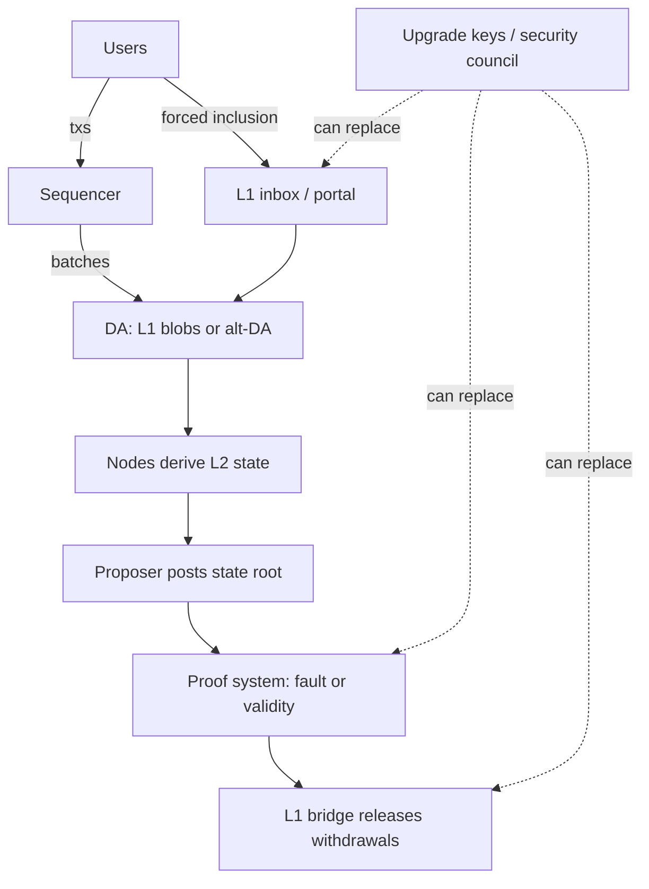

# The Anatomy of Rollup Trust

A rollup executes transactions off L1 and posts data and state commitments to L1. Its marketing usually says "secured by Ethereum". The precise truth depends on several separable components, each with its own failure modes.

## Components

| Component | Role | Failure if malicious or down |
|---|---|---|
| Sequencer | orders transactions, issues soft confirmations | censorship, reordering (MEV), downtime |
| Data availability (DA) | publishes transaction data (L1 blobs or alt-DA) | users cannot reconstruct state or prove withdrawals |
| State proposer | posts state roots to L1 | invalid roots (if proofs are weak), stalled withdrawals |
| Proof system | fault proofs (optimistic) or validity proofs (ZK) | invalid state accepted, or valid state rejected |
| Bridge contracts | hold L1 assets; process deposits/withdrawals | theft or freeze |
| Upgrade keys / security council | can change all of the above | everything |



The dashed arrows are the reason the last row of the table says "everything". A rollup's effective security is the weaker of its proof system and its upgrade path.

## The "stages" framework

L2BEAT's stages (Stage 0, 1, 2) classify rollups by how much users depend on operators and councils:
- **Stage 0:** operators/councils can do essentially anything; proofs may not be live.
- **Stage 1:** a working proof system, but a security council can override it (with constraints).
- **Stage 2:** the proof system rules; upgrades have exit windows long enough for users to leave.

Use it as a vocabulary for reviews, not as a certification.

## Review questions

1. Can users force their transactions in if the sequencer censors them?
2. Can users withdraw if the operator disappears?
3. Who can upgrade the bridge, how fast, and can users exit before an upgrade takes effect?
4. Is the proof system live and permissionless?
5. Where is the data, and what happens if the DA layer withholds it?

## Worked example

*Execution status: not executed in this book's CI; verify locally. Addresses are placeholders you look up from the rollup's own documentation or L2BEAT.*

We answer question 3 for an OP Stack chain using only L1 reads: who can upgrade the bridge, and how fast.

**Step 1: find the proxy and its admin.** OP Stack L1 contracts are ERC-1967 proxies. The admin is stored in the standard admin slot:

```bash
PORTAL=0x...   # OptimismPortal proxy, from the chain's docs
ADMIN_SLOT=0xb53127684a568b3173ae13b9f8a6016e243e63b6e8ee1178d6a717850b5d6103
cast storage $PORTAL $ADMIN_SLOT --rpc-url $ETH_RPC
```

The result (left-padded to 32 bytes) is the `ProxyAdmin` contract.

**Step 2: who owns the ProxyAdmin?**

```bash
cast call $PROXY_ADMIN "owner()(address)" --rpc-url $ETH_RPC
```

If the owner is a Safe, read its configuration:

```bash
cast call $OWNER "getThreshold()(uint256)" --rpc-url $ETH_RPC
cast call $OWNER "getOwners()(address[])" --rpc-url $ETH_RPC
```

If the owner is a timelock, read its delay (for an OpenZeppelin `TimelockController`, `getMinDelay()`). If the Safe has modules or a guard, list them too (`getModulesPaginated`, the guard storage slot), because modules can bypass the threshold.

**Step 3: record the path.** Write it as a chain:

| Hop | Example finding | Delay |
|---|---|---|
| Portal proxy admin | ProxyAdmin contract | 0 |
| ProxyAdmin owner | 2-of-2 Safe (foundation + council) | 0 |
| Council Safe | 10-of-13 signers | 0 |
| **Effective upgrade delay** | | **0 (instant upgrade with council approval)** |

This hypothetical result is typical of Stage 0/1 systems: no delay, so users cannot exit before an upgrade. The security of bridged funds equals the security of those signer keys.

**Step 4: cross-check.** Compare with L2BEAT's page for the chain. If your reading and theirs differ, find out why; upgrades happen, and either source can be stale. The chain itself is the ground truth.

## Common pitfalls

- Trusting "secured by Ethereum" without reading the upgrade path.
- Checking the bridge proxy but not the proof-system contracts, which can be swapped independently.
- Ignoring Safe modules and guards, which can change who effectively controls a multisig.
- Treating soft confirmations as final for high-value actions.
- Assuming blob data is available forever; blobs are pruned after a limited period, so long-term data availability depends on archivers.

## Exercises

1. Pick two rollups and answer the five questions using their docs and L2BEAT's risk pages.
2. Find the upgrade path (multisig, timelock, council) for one rollup's bridge on L1.
3. Explain the difference between a soft confirmation and L1 finality for a user.
4. Repeat the worked example for the rollup's dispute-game factory or verifier contract and compare its upgrade path with the bridge's.

## Further reading

- L2BEAT: <https://l2beat.com>
- L2BEAT stages framework: <https://forum.l2beat.com> (search "stages")
- Ethereum.org on rollups: <https://ethereum.org/en/developers/docs/scaling/>
- EIP-4844 (blobs): <https://eips.ethereum.org/EIPS/eip-4844>
- ERC-1967 (proxy storage slots): <https://eips.ethereum.org/EIPS/eip-1967>
