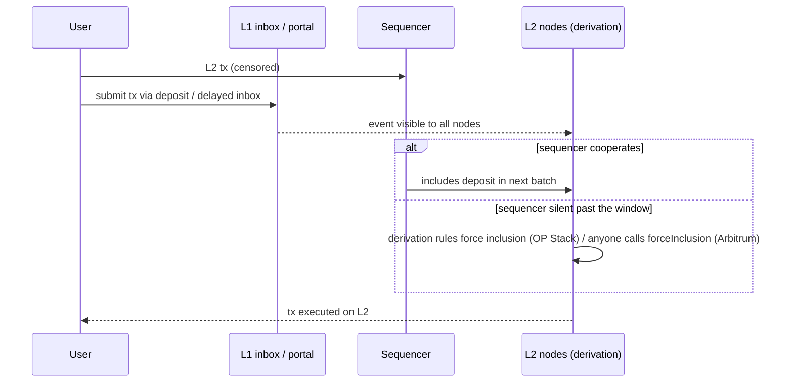

# Sequencer Risks

Most rollups run a single centralised sequencer. It sees every transaction first and decides ordering.

## Risks

- **Censorship:** the sequencer refuses specific users or contracts.
- **Downtime:** the chain halts; time-sensitive protocols (liquidations, oracles) break. Several L2s have had multi-hour outages.
- **MEV extraction / reordering:** the sequencer can front-run users unless constrained.
- **Soft-confirmation equivocation:** the sequencer promises one order, then posts another to L1. Users and bridges relying on soft confirmations can be harmed.
- **Key compromise:** the sequencer key can be used to post malicious batches. Whether that steals funds depends on the proof system.

## Forced inclusion

The main censorship defence: users submit transactions to an L1 contract (e.g. Optimism's `OptimismPortal` deposit path, Arbitrum's delayed inbox). After a delay, the sequencer must include them, or anyone can force them in.



Review points:
- What is the delay (hours? a day?), and is it short enough for the user's needs?
- Can *any* L2 action be forced, including withdrawals?
- Is forcing permissionless, and does it work when the sequencer is fully offline?

The mechanisms differ. In the OP Stack, deposits are part of the derivation rules: L2 nodes must include them, and if the sequencer posts nothing for longer than the sequencing window, nodes derive blocks containing the deposits themselves. In Arbitrum, messages in the delayed inbox can be force-included by anyone after the configured delay by calling the sequencer inbox. Read the current parameters from each chain's contracts or docs; they are configurable and have changed over time.

## Protocol-level mitigations for apps

- Check sequencer uptime before using oracle prices (see **oracle-security-engineering**).
- Add grace periods after restarts for liquidations.
- Avoid assumptions that L2 timestamps are reliable during outages.

## Decentralised and shared sequencing

Proposals include sequencer rotation, shared sequencers across rollups and "based" rollups where L1 proposers sequence. Each moves trust rather than removing it; review what new parties gain ordering power.

## Worked example

*Execution status: not executed in this book's CI; verify locally on a devnet or testnet. The timing arithmetic is by hand under stated assumptions.*

We force a withdrawal-initiating call through the OP Stack L1 portal, then work out the worst-case time a censored user waits.

**Step 1: the L1 call.** `OptimismPortal.depositTransaction(address _to, uint256 _value, uint64 _gasLimit, bool _isCreation, bytes _data)` creates a deposit that L2 must execute. To call the L2 withdrawal contract (`L2ToL1MessagePasser` at the predeploy `0x4200000000000000000000000000000000000016`) without the sequencer's help:

```bash
DATA=$(cast calldata "initiateWithdrawal(address,uint256,bytes)" $ME 100000 0x)
cast send $PORTAL "depositTransaction(address,uint256,uint64,bool,bytes)" \
  0x4200000000000000000000000000000000000016 0 200000 false $DATA \
  --value 0.01ether --rpc-url $L1_RPC --private-key $TEST_PK
```

Use a testnet or a local OP Stack devnet and a throwaway key. The deposit emits `TransactionDeposited` on L1; watch for the corresponding L2 transaction with `cast receipt` on the L2 RPC once it is derived.

**Step 2: worst-case inclusion time.** Assume a sequencing window of 12 hours (check the chain's configuration) and a fully offline sequencer:

| Phase | Time |
|---|---|
| L1 deposit inclusion | ~1 block |
| Sequencer posts nothing; window elapses | up to 12 h |
| Nodes derive blocks containing the deposit | minutes |
| **Worst case to L2 execution** | **≈ 12 h** |

**Step 3: who is harmed in that window?** Consider a lending position on the L2 at 85% LTV. If the sequencer goes offline and ETH falls 10% on L1 markets during those 12 hours, the user cannot add collateral through the normal path. When the sequencer returns, the oracle updates and the position is liquidatable immediately, before the user can act. This is why Chapter 2 of **oracle-security-engineering** insists on a grace period after sequencer restarts. Forced inclusion helps a censored user; it does not help when everyone is waiting for the same restart.

**Step 4: test the app side.** In a Foundry test on an L2 fork, mock the Chainlink sequencer uptime feed to report "down", then "up" with `startedAt = block.timestamp`, and assert that your protocol rejects liquidations until the grace period passes.

## Common pitfalls

- Assuming forced inclusion is fast; windows are measured in hours.
- Designing protocols that treat L2 `block.timestamp` as continuous during outages.
- No grace period after sequencer restarts for liquidations and oracle-dependent actions.
- Relying on soft confirmations for cross-chain bridging or large payments.
- Treating shared or decentralised sequencers as removing trust rather than redistributing it.
- Testing forced inclusion only while the sequencer is up.

## Exercises

1. Use the forced-inclusion path on a testnet rollup and measure time to inclusion.
2. Find a historical L2 outage and list which DeFi protocols paused or failed.
3. Model a sequencer that equivocates on soft confirmations. Who loses?
4. Read Arbitrum's current delayed-inbox parameters from its L1 contracts and compute its worst-case forced inclusion time as in Step 2.

## Further reading

- Arbitrum delayed inbox / censorship resistance: <https://docs.arbitrum.io>
- Optimism deposit flow: <https://docs.optimism.io>
- OP Stack derivation spec (sequencing window): <https://specs.optimism.io>
- L2BEAT risk rosettes per project: <https://l2beat.com>
