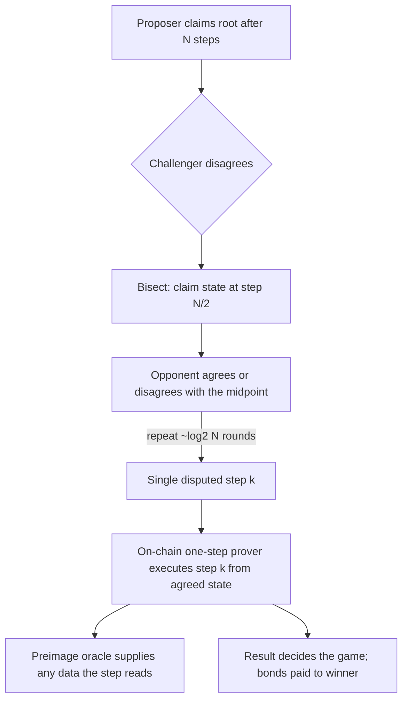

# Fault Proofs (Optimistic Rollups)

Optimistic rollups post state roots that are assumed valid unless challenged. A **fault proof** lets anyone show a root is wrong by narrowing a dispute to a single instruction, which is executed on L1.

## Components

- **Dispute game:** interactive bisection between claimant and challenger over the execution trace.
- **One-step prover:** an on-chain VM interpreter (MIPS for Optimism's Cannon, WASM-based for Arbitrum) that executes the single disputed instruction.
- **Preimage oracle:** provides L1/L2 data needed by the program in a verifiable way.
- **Bonds and timeouts:** economic incentives and liveness rules.



For a trace of `2^40` steps, bisection needs about 40 rounds. Each round is a transaction, and each side has a clock. The design goal is that an honest party can always finish in time and afford the bonds.

## Bug classes

| Class | Example |
|---|---|
| One-step prover mismatch | on-chain VM semantics differ from off-chain VM for an edge-case instruction |
| Preimage oracle errors | wrong data accepted for a key; size or offset handling |
| Game logic | clock mishandling; moves allowed after resolution; incorrect bond accounting |
| Delay attacks | adversary forces many sub-games, exhausting honest parties' funds or time |
| Resource exhaustion | honest challengers cannot afford gas or bonds against a well-funded attacker |

Arbitrum's BoLD protocol was designed to bound dispute time regardless of the number of adversarial claims. Analysing such "delay attack" resistance is a good research topic.

## Differential testing

The off-chain VM (e.g. Cannon's Go implementation) and the on-chain one-step prover must agree exactly. Differential fuzzing (random instructions and states, compare post-states) is the main assurance technique, and it suits distributed compute (see **decentralized-security-compute**).

## Worked example

*Execution status: Part A was executed with Python 3 when this chapter was written, and the output shown is what it printed. It uses toy implementations, not Cannon or the real MIPS contract. Part B is hand arithmetic.*

**Part A: differential fuzzing a single instruction.** MIPS `SRAV` shifts a register right arithmetically by the low five bits of another register. Here is a reference implementation and a toy "on-chain port" that forgets to mask the shift amount:

```python
import random
MASK = 0xFFFFFFFF
def signed(x): return x - (1 << 32) if x & 0x80000000 else x
def srav_ref(rt, rs):                     # MIPS SRAV: shift amount is the low 5 bits of rs
    return (signed(rt) >> (rs & 0x1F)) & MASK
def srav_onchain(rt, rs):                 # toy one-step-prover port: forgets to mask rs
    return (signed(rt) >> min(rs, 31)) & MASK
random.seed(7)
for i in range(1, 100_001):
    rt = random.getrandbits(32)
    rs = random.getrandbits(32) if random.random() < 0.5 else random.randrange(32)
    if srav_ref(rt, rs) != srav_onchain(rt, rs):
        print(f"divergence after {i} cases: rt=0x{rt:08x} rs=0x{rs:08x} "
              f"ref=0x{srav_ref(rt, rs):08x} onchain=0x{srav_onchain(rt, rs):08x}")
        break
else:
    print("no divergence in 100000 cases")
```

Output:

```text
divergence after 2 cases: rt=0xa6a3a450 rs=0xd23f0824 ref=0xfa6a3a45 onchain=0xffffffff
```

`rs = 0xd23f0824` has low five bits `0b00100 = 4`, so the reference shifts by 4; the buggy port clamps to 31 and returns all ones. In a real system that divergence means an honest party computing off-chain and the on-chain prover disagree on one step. Whoever is "right" by the on-chain prover wins the game, so an attacker who finds such a step can win disputes about false roots.

Notice the generator: half the cases draw `rs` from the full 32-bit range. A generator that only produced valid-looking shift amounts (0–31) would never find this. In real harnesses, the reference is the off-chain VM (Go), the target is the Solidity one-step prover run via Foundry or an EVM library, and the input includes full register and memory state.

**Part B: capital for a naive game.** Suppose a naive design where each adversarial claim must be countered separately, each counter needs a 0.08 ETH bond and about 40 moves at 150 000 gas, and gas costs 20 gwei.

| Item | Per claim |
|---|---|
| Bond | 0.08 ETH |
| Gas: 40 × 150 000 × 20 gwei | 0.12 ETH |
| **Total locked or spent by honest party** | **0.20 ETH** |

Against 1 000 adversarial claims, the honest party needs about 200 ETH available at once, although it should recover bonds and be reimbursed if it wins. The attacker needs comparable capital but only to *delay*, not to win. Designs such as BoLD aim to make the honest party's cost independent of the number of adversarial claims; checking that property is the core of a delay-attack review. (The numbers here are illustrative; real bonds and gas costs are set per deployment.)

## Common pitfalls

- Differential tests whose input generators never reach edge cases (large shift amounts, unaligned memory, overflow).
- Comparing only register outputs and not memory, preimage reads or exit codes.
- Assuming the challenger infrastructure will run when needed; nobody may be watching.
- Ignoring the cost of being honest: bonds and gas under adversarial load.
- Treating a fault-proof system as live when a council can still override results without delay.

## Exercises

1. Read Optimism's fault proof specs and draw the dispute game tree.
2. Differentially fuzz a simple MIPS instruction subset between a Go emulator and a Solidity one-step prover (toy versions).
3. Estimate the capital an honest challenger needs to defend against N adversarial claims in a naive game.
4. Extend Part A to `SLLV` and `SRLV`, and add a generator that biases toward boundary values (0, 31, 32, `0xFFFFFFFF`).

## Further reading

- Optimism fault proof specs: <https://specs.optimism.io>
- Arbitrum BoLD: <https://docs.arbitrum.io> (search "BoLD")
- Kalodner et al., "Arbitrum: Scalable, private smart contracts", USENIX Security 2018
- Optimism monorepo (Cannon and MIPS contracts): <https://github.com/ethereum-optimism/optimism>
