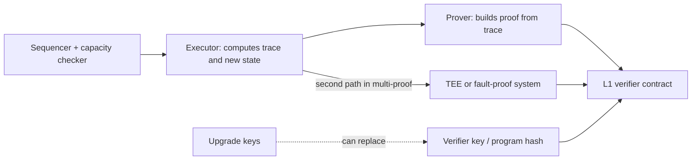

# Validity Proofs and Prover Security

ZK rollups post a validity proof with each state update. Soundness depends on circuits, proof systems and verifiers, all covered in **zk-circuit-security**. Rollup-specific concerns are below.

## Rollup-specific risks

- **Circuit/EVM mismatch:** zkEVMs encode EVM semantics in circuits. Any mismatch (gas, precompiles, edge-case opcodes) is either a soundness bug (proving invalid execution) or a completeness bug (valid transactions that cannot be proven, causing halts).
- **Prover liveness:** if only the operator can prove, the chain halts when it stops. Permissionless proving or fallback mechanisms matter.
- **Unprovable transactions:** attackers craft transactions that the prover cannot prove (exceed circuit limits). Rollups mitigate with circuit capacity checks at sequencing time. Mismatches between the checker and actual limits cause halts.
- **Verifier upgrades:** a new verifier key can change what is provable. Upgrade controls are critical.
- **Multi-proof designs:** some rollups require two independent proof systems (e.g. ZK + TEE, or ZK + fault proof) to agree, reducing reliance on one implementation.

| Mismatch direction | Consequence | Who is harmed |
|---|---|---|
| Circuit accepts what the EVM rejects | soundness bug: invalid state can be proven | all bridged funds |
| Circuit rejects what the EVM accepts | completeness bug: chain halts or tx is dropped | liveness; users stuck |
| Capacity checker looser than circuit | sequenced block cannot be proven | liveness |
| Capacity checker tighter than circuit | valid txs refused | usability, possible censorship vector |

## Where the pieces sit



The executor and the circuit must implement the same semantics, the capacity checker must predict the circuit's limits exactly, and the verifier key must correspond to the audited circuit. A review checks each of those three equalities.

## Assurance techniques

- Differential testing of the zkEVM against reference EVM clients using execution spec tests.
- Formal verification of circuit components (several zkEVM teams have published work on this).
- Audits by circuit specialists; bug bounties sized to TVL.

## Worked example

*Execution status: not executed in this book's CI; verify locally. Tool flags change between releases; check `--help` for your versions.*

We run Ethereum's execution-spec state tests against a reference client and a zkEVM's executor, and compare. This tests the executor's semantics, which the circuit must then match; it does not test the circuit itself.

**Step 1: get fixtures.** The `execution-spec-tests` repository publishes fixture releases (JSON state tests generated for each fork). Download a release archive and unpack it into a directory of your choice.

**Step 2: reference run.** go-ethereum's `evm` tool can execute state tests:

```bash
evm statetest fixtures/state_tests/cancun/eip1153_tstore/ > ref.jsonl 2>&1
```

Each test reports pass or fail plus the resulting state root. A passing reference run confirms your fixtures and tooling are consistent.

**Step 3: target run.** Most zkEVM projects ship a way to run state tests against their executor (often a test harness in their repository). Run the same fixtures and produce the same per-test output format. Then compare:

```bash
jq -r '[.name, .pass, .stateRoot] | @tsv' ref.jsonl    | sort > ref.tsv
jq -r '[.name, .pass, .stateRoot] | @tsv' target.jsonl | sort > target.tsv
diff ref.tsv target.tsv | head
```

(Adapt the `jq` fields to each tool's actual output.)

**Step 4: classify differences.**

| Difference | Likely meaning | Severity question |
|---|---|---|
| Reference passes, target fails with "unsupported" | known unsupported feature | is it documented and blocked at the sequencer? |
| Both pass, different state roots | semantic divergence | can a user trigger it on mainnet? |
| Target passes a test the reference fails | target accepts invalid execution | potential soundness bug if the circuit follows the executor |

The third row is the alarming one. Reduce the fixture to the smallest case, confirm the circuit accepts the corresponding trace (on a local prover if feasible), and report privately through the project's bug bounty.

**Step 5: capacity limits.** Read the documented circuit limits (for example, maximum number of Keccak rounds or certain precompile calls per block) and write a transaction that sits exactly at the limit and one just over. The sequencer's capacity checker should accept the first and reject the second. If it accepts both, you have found a potential halt condition: a block that cannot be proven.

## Common pitfalls

- Treating a passing executor test suite as evidence the circuit is correct.
- Running only the fixtures for the latest fork while the chain implements a mix of forks.
- Ignoring precompiles, which are often partially supported or implemented separately.
- Capacity checkers maintained separately from circuits, drifting out of sync.
- Verifier key upgrades without an independent check that the new key matches the audited circuit.
- Single-prover designs with no fallback when the operator's prover stops.

## Exercises

1. Run execution-spec tests against a zkEVM's executor (not prover) and look for divergences.
2. Find a zkEVM's documented circuit capacity limits and design a transaction that hits one.
3. Compare two multi-proof designs and list what each protects against.
4. For one rollup, trace how a new verifier key reaches the L1 verifier contract and who can approve it.

## Further reading

- Ethereum execution spec tests: <https://github.com/ethereum/execution-spec-tests>
- go-ethereum (`evm` tool): <https://github.com/ethereum/go-ethereum>
- Chaliasos et al., "SoK: What Don't We Know? Understanding Security Vulnerabilities in SNARKs", USENIX Security 2024
- L2BEAT per-project proof system pages: <https://l2beat.com>
