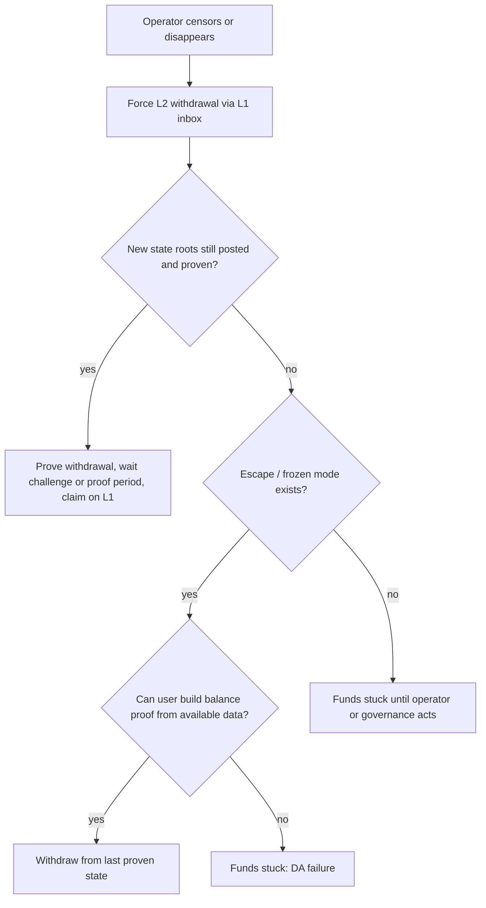

# Escape Hatches and Upgrade Governance

The final guarantee of a rollup is whether users can leave with their assets when everything else fails, and whether governance can take that ability away.

## Escape hatches

- **Forced withdrawals** via L1 when the sequencer censors.
- **Escape mode / frozen mode:** some designs let users withdraw directly from the last proven state if the operator stops (common in app-specific ZK rollups, e.g. StarkEx-based "escape hatch").
- **Data needed to exit:** users must be able to compute proofs of their balance, which requires data availability. With off-chain DA (validiums), a data committee withholding data can block exits.

Every "stuck" leaf is a place where users depend on someone else's cooperation. A Stage 2 system has no such leaf reachable within the exit window.

## Upgrade governance

| Pattern | User protection |
|---|---|
| Instant upgrade by multisig | none |
| Timelock (e.g. 7 days) | users can exit before upgrade, if exits take less than the timelock |
| Security council with emergency powers | fast response to bugs; trust in council members |
| Exit window ≥ 30 days, council limited to proof-system disputes | Stage 2-like |

A useful check: **exit window = upgrade delay − time to withdraw**. If withdrawals take 7 days and the upgrade delay is 7 days, the exit window is zero.

"Time to withdraw" includes more than the challenge period. Add the forced-inclusion delay (the sequencer may be hostile during a malicious upgrade), the time for a state root containing the withdrawal to be posted, and a margin for users to notice the upgrade at all.

## Review checklist

- [ ] Forced inclusion path works with sequencer fully offline.
- [ ] Withdrawal possible without operator cooperation.
- [ ] Data for exit proofs is available independent of the operator.
- [ ] Upgrade delay exceeds withdrawal time by a meaningful margin.
- [ ] Emergency powers are scoped, documented and logged on-chain.

## Worked example

*Execution status: the exit-window table is hand arithmetic from the hypothetical parameters shown; the `cast` reads were not executed in this book's CI; verify locally.*

We compute realistic exit windows for three hypothetical rollups, then show how to read the inputs on-chain.

**Step 1: the inputs.**

| Parameter | Rollup A (optimistic) | Rollup B (optimistic) | Rollup C (ZK) |
|---|---|---|---|
| Upgrade delay | 0 (council multisig) | 8 days | 30 days |
| Forced-inclusion worst case | 12 h | 24 h | 24 h |
| Root posting interval | 1 h | 1 h | 6 h (proof batches) |
| Challenge / finalisation period | 7 days | 7 days | ~0 after proof |
| Margin for users to notice | 1 day | 1 day | 1 day |

**Step 2: time to withdraw under a hostile operator.**

| | A | B | C |
|---|---|---|---|
| Forced inclusion | 0.5 d | 1 d | 1 d |
| Root posting | ≈ 0.04 d | ≈ 0.04 d | 0.25 d |
| Challenge period | 7 d | 7 d | 0 d |
| Notice margin | 1 d | 1 d | 1 d |
| **Total** | **≈ 8.5 d** | **≈ 9.0 d** | **≈ 2.25 d** |

**Step 3: exit windows.** A: 0 − 8.5 = negative; users cannot exit. B: 8 − 9.0 = −1 day; despite the timelock, an attentive user still cannot finish withdrawing in time. C: 30 − 2.25 ≈ 27.75 days; comfortable. Rollup B is the instructive case: a timelock that looks protective is a day too short once forced inclusion and notice time are counted.

Note a subtlety for C: if the operator stops *proving* rather than censoring, the "≈ 0 after proof" assumption fails, and the exit depends on an escape hatch or permissionless proving. Repeat the calculation for that scenario.

**Step 4: read the real inputs.** For each rollup, read the timelock delay on the upgrade path found in Chapter 1 (`getMinDelay()` for OpenZeppelin timelocks, or the project's own delay getter), the finalisation period from the bridge or dispute contracts (OP Stack's `OptimismPortal` and dispute game contracts expose their timing parameters; Arbitrum's rollup contract exposes its confirmation period in blocks), and the forced-inclusion parameters from Chapter 2. Record the block number at which you read them, because they change with upgrades.

## Common pitfalls

- Computing exit windows from the challenge period alone, ignoring forced inclusion and notice time.
- Assuming validiums offer the same exit guarantees as rollups.
- Trusting escape hatches that have never been exercised on a testnet.
- Emergency powers broad enough to upgrade anything instantly, labelled "for bugs only".
- Timelocks that the same multisig can bypass via a separate emergency path.

## Exercises

1. Compute the exit window for three rollups from their published parameters.
2. Simulate an operator disappearance on a local devnet and attempt an escape-hatch withdrawal.
3. Write a policy proposal for a security council's emergency powers.
4. Redo the worked example for Rollup C with the operator refusing to prove, assuming permissionless proving that takes 12 hours to start.

## Further reading

- L2BEAT "exit window" metrics: <https://l2beat.com>
- StarkEx escape hatch docs: <https://docs.starkware.co>
- Vitalik Buterin's blog posts on rollup "training wheels" and stages: <https://vitalik.eth.limo>
