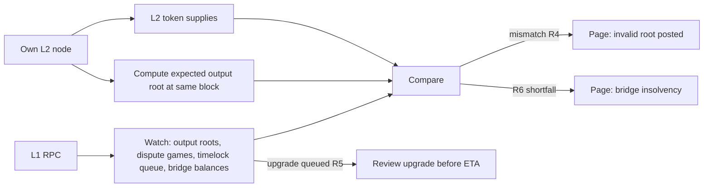

# Running an L2 Security Review

This chapter turns the book into a review procedure: scope, invariants, monitoring, and how to rank what you find.

## Scope

1. L1 contracts: bridge/portal, rollup/state commitment contracts, dispute game or verifier, upgrade/proxy admin, council multisigs.
2. Off-chain: sequencer, batcher, proposer, challenger/prover, node software.
3. Proof system: VM or circuits.
4. Operations: key management, monitoring, incident runbooks.

## Invariants

```
R1 every L1 withdrawal corresponds to an L2 burn/withdrawal in a finalised/proven state
R2 deposits are credited exactly once on L2
R3 forced inclusions are processed within the documented delay
R4 an invalid state root never finalises (optimistic: if any honest challenger acts)
R5 upgrades cannot take effect before the documented delay
R6 total L1-held assets >= total L2 claims (per asset)
```

Monitor R1, R2, R5 and R6 live. They are the rollup equivalent of a bridge conservation monitor (see **cross-chain-bridge-security**).

## Monitoring

- New state roots vs independently computed roots (run your own node and compare).
- Dispute games created and their status.
- Upgrade transactions queued in timelocks.
- Sequencer liveness and batch posting delays.



## Prioritising findings

L2 reviews produce findings of very different weight. Rank them by what they allow: theft of bridged funds or acceptance of invalid state first; permanent freezing of funds second; censorship or extended delays third; operational issues last. Upgrade-key findings deserve special treatment, because a compromised upgrade key reaches the top category regardless of how good the rest of the system is. State clearly which findings depend on trust in the operator or security council, so users can understand their real risk.

## Worked example

*Execution status: not executed in this book's CI; verify locally. Addresses are placeholders taken from the chain's documentation.*

We implement two monitors for an OP Stack chain: R6 for a bridged ERC-20, and R4 by comparing posted output roots with our own node.

**Step 1: R6 for a bridged ERC-20.** The OP Stack `L1StandardBridge` keeps a public mapping `deposits(l1Token, l2Token)` with the amount locked for each pair. On L2, the corresponding `OptimismMintableERC20` has a `totalSupply`.

```bash
LOCKED=$(cast call $L1_BRIDGE "deposits(address,address)(uint256)" $L1_TOKEN $L2_TOKEN --rpc-url $L1_RPC)
SUPPLY=$(cast call $L2_TOKEN "totalSupply()(uint256)" --rpc-url $L2_RPC)
echo "locked=$LOCKED l2supply=$SUPPLY"
```

R6 holds if `LOCKED >= SUPPLY`. Expect small timing differences: withdrawals in flight have been burned on L2 but not yet released on L1 (so `LOCKED > SUPPLY` temporarily), and deposits in flight are locked on L1 but not yet minted on L2. Alert only if `SUPPLY > LOCKED` persists across several blocks. Read both values at known block heights (`--block`) so the comparison is consistent.

**Step 2: R6 for ETH.** ETH bridged to OP Stack chains is held by the `OptimismPortal`. Compare `cast balance $PORTAL` on L1 with the sum of L2 ETH balances, which is not a single call; approximate it from your own node's state, or track deposits minus withdrawals from events. The method matters less than consistency: pick one, document it, and alert on changes in the gap rather than its absolute value.

**Step 3: R4 output roots.** Run your own L2 node (op-geth plus op-node). For each new output root proposal on L1, ask your own op-node for the root at the same L2 block:

```bash
cast rpc optimism_outputAtBlock $(cast to-hex $L2_BLOCK) --rpc-url $OP_NODE_RPC
```

Compare its `outputRoot` with the root claimed on L1 (from the dispute game's `rootClaim()` or the proposal event, depending on the deployed version). A mismatch is either a bug in your node or an invalid proposal. Both need a human immediately, and the second needs a challenger to act within the dispute window.

**Step 4: R5 timelock watch.** For every timelock on the upgrade path, subscribe to its "scheduled" events. For each queued operation, decode the calldata (Chapter 3 of **governance-attack-engineering** shows how), simulate it on a fork, and post the state diff before its ETA. If the path has no timelock, note that R5 is vacuous and raise it as a finding.

**Step 5: test the alerts.** On a local devnet, mint extra L2 tokens through a test-only path to break R6, and post a deliberately wrong output root to break R4. Both alerts should fire. A monitor that has never fired in a drill is not yet a control.

## Ongoing assurance

Reviews are snapshots. Rollups upgrade frequently, so pair each review with monitoring of the invariants above and a process to re-review every upgrade before it executes.

## Common pitfalls

- Monitoring posted roots without an independent node to compare against.
- R6 checks that alert on normal in-flight deposits and withdrawals, training people to ignore them.
- Reviewing L1 contracts but treating off-chain components (batcher, proposer, challenger) as out of scope.
- Ranking findings by code complexity instead of by what they allow.
- Forgetting that a monitor's RPC provider is itself a dependency that can lie or fail.

## Exercises

1. Run a rollup full node and compare its computed state roots with posted ones for a day.
2. Implement R6 for ETH on one rollup.
3. Write the incident runbook for "invalid state root posted".
4. Implement the R5 watcher for one rollup and post a simulated state diff for its next queued upgrade.

## Further reading

- OP Stack specs: <https://specs.optimism.io>
- Arbitrum docs: <https://docs.arbitrum.io>
- L2BEAT: <https://l2beat.com>
- OP Stack node RPC reference (`optimism_outputAtBlock`): <https://docs.optimism.io>
